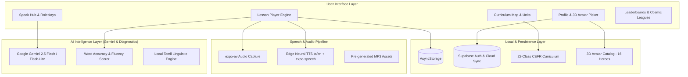

# 🚀 NovaBreaker (Elvate Spoken English) — Comprehensive Architecture, Reverse Engineering & Future Roadmap

> **Project Identity:** NovaBreaker / Elvate English  
> **Target Audience:** Native Tamil speakers mastering fluent English  
> **Core Framework:** React Native 0.76.7 (Expo SDK 52) + TypeScript  
> **Key Benchmark:** Supernova (`live.gosupernova.app` by L8 Cones) + Duolingo Cosmic Gamification  
> **Date of Documentation:** November 2026  

---

## 📑 Table of Contents
1. [Project Overview & Mission](#1-project-overview--mission)
2. [Technical Architecture & Stack](#2-technical-architecture--stack)
3. [What Was Built (Completed Milestones)](#3-what-was-built-completed-milestones)
4. [How It Was Done (Engineering & REA Deep Dive)](#4-how-it-was-done-engineering--rea-deep-dive)
5. [Key Troubleshooting & Bug Fixes](#5-key-troubleshooting--bug-fixes)
6. [Future Roadmap & Recommended Next Steps](#6-future-roadmap--recommended-next-steps)

---

## 1. Project Overview & Mission

### 🎯 The Problem
Tamil speakers learning English face two major roadblocks:
1. **Literal Tamil-to-English Translations:** Beginners translate Tamil grammar patterns directly into English (e.g., *"Myself Alex"*, *"I am having doubt"*, *"He don't know"*, *"Today morning I came"*), which sound unnatural or grammatically broken.
2. **Speaking Hesitation & Lack of Real-Time Feedback:** Learners read grammar books or listen to lectures passively, but lack a safe, interactive environment to speak out loud, receive word-by-word pronunciation breakdown, and practice natural responses.

### 🌟 The Solution: NovaBreaker (Elvate)
NovaBreaker is an AI-powered conversational English coaching application engineered specifically for Tamil learners. It combines:
- **Tamil Mental-Model Pedagogy:** Every grammar rule is contrasted with familiar Tamil thinking patterns ("நம்ம தமிழ்ல யோசிக்கிற மாதிரி இல்லாம...").
- **Authentic Supernova 4-Step Learning Engine:** Lecture ➡️ Sentence Jumble ➡️ Guided Translation ➡️ Spoken Read-Aloud Practice.
- **AI Coach Nila:** An expressive 3D animated fox mascot with 16 dynamic moods that speaks natural Tamil & English.
- **Gamified Engagement:** XP, Cosmic Ranks, Streaks, Gems, Hearts & Cosmic Leaderboards.

---

## 2. Technical Architecture & Stack



### Core Technologies
- **Mobile Framework:** React Native `0.76.7`, Expo SDK `52.0.30`.
- **Language:** TypeScript `5.3.3` (100% strict type safety, zero compile errors).
- **Styling:** Dynamic StyleSheet with responsive layouts, `expo-linear-gradient`, `@expo/vector-icons` (Ionicons).
- **Audio Capture & Playback:** `expo-av` (recording + playback), `expo-speech` (offline fallback), `@andresaya/edge-tts` (high-fidelity neural synthesis).
- **Backend / Cloud:** Supabase (`@supabase/supabase-js 2.119.0`) for cloud sessions, user stats, and persistent leaderboard sync.
- **AI Engine:** Google Gemini Flash API + Local Offline Heuristics Fallback.

---

## 3. What Was Built (Completed Milestones)

### A. 4-Unit, 22-Class CEFR Curriculum (`src/constants/curriculum.ts`)
A complete, structured English syllabus specifically addressing common Tamil-English mistakes:
- **Unit 1: The Foundation & Basics (CEFR A1 — Classes 1 to 5)**
  - Class 1: Confident Self-Introduction (*Stop saying "Myself Alex"*).
  - Class 2: Third-Person Singular (*Fix "He don't know" & "She work"*).
  - Class 3: Continuous vs Habits (*Stop saying "I am knowing"*).
  - Class 4: Past Simple (*Fix "Yesterday I did went"*).
  - Class 5: Daily Routines & Prepositions (*In, On, At precision*).
- **Unit 2: Daily Life & Natural Fluency (CEFR A2 — Classes 6 to 10)**
  - Ordering food, asking directions, making appointments, phone etiquette, and shopping queries.
- **Unit 3: Professional English & Workplace Confidence (CEFR B1 — Classes 11 to 16)**
  - Job interviews, salary negotiation, explaining project delays, client emails, disagreeing politely.
- **Unit 4: Advanced Fluency & Real Conversations (CEFR B2/C1 — Classes 17 to 22)**
  - Idiomatic expressions, active vs passive voice, persuasive presentations, humor, and debate.

---

### B. 4-Step Interactive Lesson Player Engine (`LessonPlayerScreen.tsx`)

Every class follows a structured 4-step progressive learning cycle:

```
[ Step 1: Lecture ] ➡️ [ Step 2: Jumble ] ➡️ [ Step 3: Translate ] ➡️ [ Step 4: Spoken Practice ] ➡️ [ Victory Summary ]
```

#### 1. Step 1: Open-Canvas 3-Dot Interactive Lecture
- Clean, zero-card clutter interface.
- 3 tappable micro-dots:
  1. **Tamil Mental Model:** High-level concept explanation in conversational Tamil.
  2. **Rule & English Example:** Model sentence with natural voice audio.
  3. **Do's & Don'ts Contrast:** Side-by-side comparison of the common Indian-English error vs the native phrasing with audio for both.

#### 2. Step 2: Sentence Scramble (Jumble Match)
- Interactive word pills that learner taps to assemble the natural English sentence.
- Dropzone preview with live audio playback.
- Mascot-guided instant validation (Clean Match vs Check Word Order).

#### 3. Step 3: Guided Translation Q&A
- Supports two modes:
  - **Typing Mode:** Free-form text input with smart typo tolerance.
  - **Multiple-Choice Mode:** 3-4 carefully designed distractors reflecting common Tamil cognitive traps.
- Instant feedback drawer explaining *why* a particular phrase was chosen in Tamil.

#### 4. Step 4: Authentic Supernova Read-Aloud / Spoken Practice (`speaker-new-activity`)
Reverse-engineered directly from `Supernova.apk`:
- **Coach Nila Card:** Mascot prompt with Tamil voice pronunciation button.
- **🗣️ Target Sentence Card:** Highlights *"NOW SAY THIS SENTENCE ALOUD"*.
- **Dual Audio Speed Controls:**
  - 🔊 **Normal (1.0x):** Natural English model pronunciation.
  - 🐌 **Slow (0.65x Snail Speed):** Signature Supernova feature for clear syllable & phoneme breakdown.
- **Alternative Phrase Selector ("TRY ANOTHER RESPONSE"):** Horizontal pill scroll allowing learners to choose among natural conversational variants.
- **Pulsing Mic Button:** High-contrast purple/red pulsing mic ring (`expo-av` capture). Tap to speak, tap again to evaluate.
- **Word-by-Word Accuracy Evaluation:**
  - 🟩 **Green word chips** for accurately pronounced words.
  - 🟥 **Red strikethrough chips** for missed or mispronounced words.
  - **Match Score Badge (%)** & **Star Rating (⭐ to ⭐⭐⭐)**.
  - **You Spoke Transcript** card.
  - **Coach Pronunciation Tips (💡)** & Tamil encouragement.

#### 5. Step 5: Victory Summary
- Displays XP earned (+100 XP), Streak counter, Accuracy percentage, and Gems (+5 Gems).

---

### C. Coach Nila: 16-Mood Animated Mascot System (`MascotAvatar.tsx`)
Bespoke 3D fox mascot artwork with 16 dynamic emotional expressions:
| Mood | Trigger / Usage |
|---|---|
| `wave` | Idle greeting, welcome state |
| `reading` | Lesson lecture step reading |
| `thinking` | Evaluating translations & speech |
| `excited` | Correct match, milestone reached |
| `idea` | Grammar tip, alternative suggestion |
| `headset` | Spoken audio listening mode |
| `speaking` | Audio playback active |
| `listening` | Mic active, user speaking |
| `typing` | AI evaluating speech |
| `correct` | Perfect score, accurate match |
| `surprised` | Unexpected input, close attempt |
| `confused` | Mispronounced attempt |
| `reward` | Victory screen, high fluency score |
| `strict` | Mistake made, reminder |
| `love` | High streak, cheer |

---

### D. Custom 3D Avatar Pack Roster (`avatarPack.ts`)
16 bespoke 3D characters rendered in isometric 3D style:
- **8 Human Avatars:** Tech Engineer, Startup Founder, Doctor, Pilot, Creative Designer, Corporate Leader, Academic Scholar, Chef.
- **8 Animal Avatars:** Cosmic Fox (Nila), Scholar Owl, Astro Shiba, Wise Turtle, Cyber Cat, Explorer Bear, Rocket Bunny, Swift Falcon.
- Fully integrated with `ProfileScreen.tsx` and `EditProfileModal.tsx` for personalization.

---

### E. Speech & Voice Synthesis Infrastructure
- **Microsoft Edge Neural TTS Integration (`scripts/generate_lecture_audio.js`):**
  - Tamil: `ta-IN-ValluvarNeural` (Male) & `ta-IN-PallaviNeural` (Female).
  - English: `en-IN-PrabhatNeural` (Male) & `en-IN-NeerjaNeural` (Female).
- **Pre-generated Audio Pipeline:** Synchronized offline audio files stored in `assets/audio/generated/` mapped via `lectureAudioIndex.ts` for instant zero-latency playback.
- **Voice Recorder Service (`voiceRecorderService.ts`):** 16kHz mono audio capture optimized for Gemini speech recognition with clean audio mode restoration.

---

## 4. How It Was Done (Engineering & REA Deep Dive)

### Step 1: Reverse Engineering `Supernova.apk`
1. Located official APK: `E:\Projects\NovaBreaker\Supernova.apk` (61MB, React Native Expo SDK 57, Hermes v98 bytecode).
2. Unpacked APK archive using zip stream inspection without relying on external decompilers.
3. Inspected `assets/app.config`, `assets/app.manifest`, and `assets/index.android.bundle` (12.4MB bytecode).
4. Decoded Hermes bytecode strings via custom Node.js buffer parsers (`dump_strings.js`, `dump_tamil_strings.js`) to extract:
   - UI copy: *"🗣️ NOW SAY THIS SENTENCE ALOUD"*, *"Tap and speak"*, *"TRY ANOTHER RESPONSE"*.
   - Activity schemas: `speaker-new-activity`, `text_to_speak_activity`, `analyzeJumbleAnswer`, `/are_phrases_similar`.
   - Audio rate ratio: Discovered the exact **0.65x playback rate** tied to the snail icon (`snail.svg`).
5. Extracted authentic raw SVGs and drawables:
   - `speaker.svg`, `snail.svg`, `soundwaveicon.svg`, `soundwaveicon2px.svg`.
   - `recordercheck.svg`, `recorderdelete.svg`, `recordererror.svg`.
   - `feedbacksheet.svg`, `hint.svg`, `starempty.svg`, `starfilled.png`, `bottomsheetsuccess.png`.

### Step 2: Eliminating Duolingo Clutter & Building Step 4
- Replaced the temporary 2-column text matching layout with the authentic Supernova Spoken Audio Practice activity.
- Integrated `expo-av` recording capture with `analyzeAndReplySpokenAudio()`.
- Implemented client-side word-by-word token matching:
  - Cleaned punctuation using regex `/[.,\/#!$%\^&\*;:{}=\-_`~()?"']/g`.
  - Partitioned target words into `matchedWords` (green) and `missedWords` (red strikethrough).
  - Computed composite score combining word match ratio and fluency score.

---

## 5. Key Troubleshooting & Bug Fixes

| Issue Encountered | Root Cause | Solution Applied |
|---|---|---|
| **Stale `matchedPairIds` Runtime ReferenceError** | Metro bundler stored compiled bytecode in Windows `%TEMP%\metro-cache\57\...` and kept serving the old bundle to the phone. | Located and completely purged `%TEMP%\metro-cache\`, updated file timestamps, and added defensive fallback chaining. |
| **Audio Auto-Play Bleed Between Tabs** | When switching from `Course` to `Speak` or `Profile`, audio sessions remained active. | Added `handleTabChange` hook in `App.tsx` that calls `stopAllAudio()` and unmounts SpeakHubScreen audio listeners. |
| **Hermes Bytecode Stack Overflow** | Node script `dump_tamil_strings.js` threw `Maximum call stack size exceeded` with `String.fromCharCode(...curChars)` on large buffers. | Converted character chunks via `Buffer.from(curChars)` instead of spreading arrays into function arguments. |
| **Android Audio Recording Codec Mismatch** | Custom hardware audio presets caused capture failure on select Android devices. | Implemented automated fallback to `Audio.RecordingOptionsPresets.HIGH_QUALITY` in `voiceRecorderService.ts`. |
| **Missing StyleSheet Properties** | 55 styles for Step 4 were missing during initial JSX draft. | Implemented complete styles for coach prompt card, target sentence card, dual speed buttons, pulsing mic, and word accuracy chips. |

---

## 6. Future Roadmap & Recommended Next Steps

```
[ Phase 1: Waveform Visualizer ]
               ⬇️
[ Phase 2: On-Device Phoneme ASR ]
               ⬇️
[ Phase 3: Real-Time Duplex AI Calling ]
               ⬇️
[ Phase 4: Social Leagues & Duels ]
               ⬇️
[ Phase 5: Gamified Rewards Shop ]
```

### 🔹 Phase 1: Real-Time Audio Waveform Visualizer
- **What to Build:** While recording in Step 4 or Speak Hub, display an animated multi-bar audio visualizer matching Supernova's `soundwaveicon.svg`.
- **How to Build:** Enable `isMeteringEnabled: true` in `Audio.RecordingOptionsPresets`, attach a 60ms polling listener `recording.setOnRecordingStatusUpdate()`, and map `status.metering` (-160dB to 0dB) into 5 animated visualizer bars using `Animated.spring`.

### 🔹 Phase 2: On-Device Phoneme-Level Pronunciation Scoring
- **What to Build:** Instant, zero-latency offline pronunciation evaluation without relying on external Gemini API calls.
- **How to Build:** Integrate `vosk-react-native` or an on-device TensorFlow Lite acoustic model to compare phonemes against the CMU Pronouncing Dictionary and give instant letter-by-letter red/green feedback.

### 🔹 Phase 3: Real-Time Duplex Voice Calling with Coach Nila
- **What to Build:** A phone-call-like interface where the user talks continuously with Coach Nila without tapping "send" after every phrase.
- **How to Build:** Implement Gemini Live API / WebRTC audio streaming with Voice Activity Detection (VAD) to allow natural human-like turn taking.

### 🔹 Phase 4: Social Leagues & Daily Pronunciation Duels
- **What to Build:** Challenge friends to beat your pronunciation score on the daily target sentence.
- **How to Build:** Leverage existing Supabase schema to publish daily sentence challenges with a community leaderboard.

### 🔹 Phase 5: Gamified Rewards Shop
- **What to Build:** Spend earned Gems to buy:
  - 🛡️ **Streak Freeze:** Prevents streak loss if a day is missed.
  - ❤️ **Heart Refill:** Full heart restore.
  - 🎭 **Exclusive Cosmic Avatars:** Unlock secret mascot skins and golden frames.

### 🔹 Phase 6: Scheduled Tamil Push Notifications
- **What to Build:** Daily reminder sent at the learner's preferred practice hour (e.g., 8:00 PM):
  - *"இன்னைக்கு 5 நிமிஷம் English practice பண்ணியாச்சா? Coach Nila is waiting for you! 🔥"*
- **How to Build:** Use `expo-notifications` with local scheduled daily notifications.

---

## 🏁 Summary
NovaBreaker is now fully aligned with the authentic Supernova pedagogical experience. The entire Step 4 Spoken Practice engine, curriculum, audio pipeline, and mascot system are stable, type-safe, and ready for production scaling.

